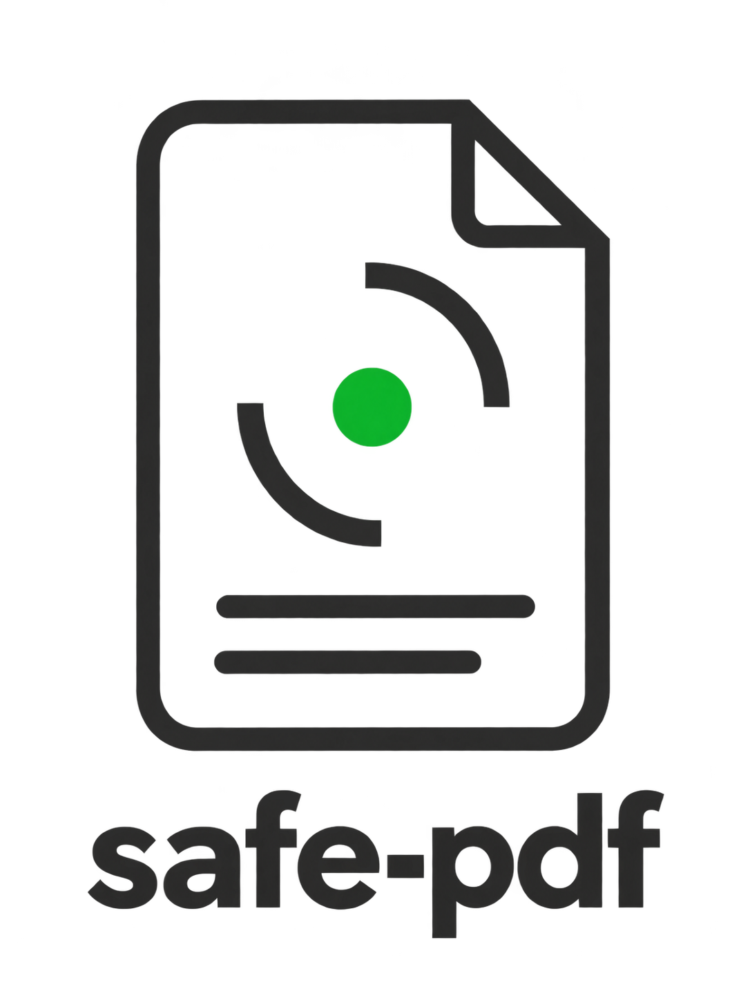

<p align="center"></p>

# safe-pdf

**A formally verified, read-only PDF viewer, written in Lean 4.**

Formally verified work on PDF has so far covered parsers only, usually for restricted subsets.
safe-pdf goes further: parsing, cross-reference resolution, decompression, the
content-stream interpreter, fonts, text extraction and rasterization form a **pure, total,
resource-bounded core** with machine-checked properties. A thin, unverified shell (window,
scrolling, clipboard) drives it.

```
bytes → Except Error Document            -- parse (untrusted input)
Document → PageIndex → DisplayList       -- interpret content streams
DisplayList → Bitmap                     -- rasterize
Document → PageIndex → PositionedText    -- text extraction with glyph positions
```

The core's types contain no `IO`, so it cannot touch the network, the file system or other
processes. The design is in [Plan.md](Plan.md); progress, decisions and known gaps are in
[progress.md](progress.md).

## What "verified" means here

The full list, with what is proven and what is only tested, is in [Plan.md §4](Plan.md#4-the-properties-what-verified-means-here).
In short:

* **Security (proven):** memory safety (no `unsafe`, no FFI in the core); **totality** — every
  core function terminates on every byte string, including xref cycles, self-referencing
  `/Length`, cyclic page trees and recursive XObjects; **bounded resources** — exceeding an
  explicit limit returns `Error.limitExceeded` instead of slowing down; no ambient authority;
  unambiguous interpretation across incremental updates; local, visible failure (a bad page
  never breaks another, repaired files are flagged).
* **Correctness (proven):** coordinate round-trips, text ↔ glyph-position correspondence,
  repair conservativity on strictly valid files, efficient parser ≡ executable spec, extracted
  text = displayed text, and saved annotations as a conservative incremental update (the
  original bytes stay a prefix).
* **Tested, not proven:** rendering faithfulness (pixel comparison against pdf.js, MuPDF and
  others), font rasterization quality, and float-level behaviour of the rasterizer.

Top-level theorems depend only on `propext`, `Classical.choice` and `Quot.sound`; the hygiene
guard (`scripts/check-hygiene.sh`) checks this and the core's coding rules on every commit.
[docs/safety.md](docs/safety.md) gives the safety account and its limits.

### Deliberately left out

JavaScript, interactive forms (AcroForm/XFA), launch actions and links to other files,
embedded-file execution, multimedia and 3D, and any network access. The viewer never modifies
the opened file in place; annotations are saved as an incremental update.

## Status

All twelve phases of the roadmap are complete and merged (milestones M0–M12; per-task record
in [progress.md](progress.md)):

* **Core (Phases 0–7):** lexer and object model, cross-reference tables and incremental
  updates, filters, document structure, encryption, the content-stream interpreter, fonts and
  text extraction, and the rasterizer, with the strict/repair parser pair and the proofs above.
* **Viewers (Phases 8–11):**
  * **macOS:** a native app, **SafePDF** (Swift/AppKit, macOS 15 or later), on top of the
    verified core through a C API.
  * **Linux (and macOS):** a Tcl/Tk viewer.
  * **What they do:** viewing, selection and search, links (external addresses are shown,
    never opened), outline, thumbnails, attachments (saved, never opened), layers,
    highlights, notes, free text and ink, saving marks into the PDF as an incremental
    update, and XFDF import/export.
* **Hardening (Phase 12),** from an independent security review:
  * every file read is capped, and a strict mode makes no repair attempts;
  * document processing runs in a sandboxed worker process that the GUI can kill and restart;
  * memory is budgeted per user operation;
  * every encrypted save gets fresh random IVs;
  * the viewer shows when a file was repaired or encrypted, and flags text that is hidden on
    the page;
  * CI re-checks every proof with an independent kernel (lean4lean) and runs a native macOS job.
* **Measured on the 81-file corpus:** every page of every file displays, 0 render errors.
  * Tk viewer: median 73 ms per page.
  * macOS app: median 103 ms, 95th percentile 401 ms; peak memory 308 MiB.

Known gaps:

* JBIG2 and JPEG 2000 images render as placeholder boxes (JPEG and CCITT fax are decoded, in
  Lean).
* `Separation`, `DeviceN` and `Lab` colours are approximated.
* VoiceOver can't read the page content in the macOS app (only its controls).
* The macOS app is ad-hoc signed, not notarised.
* The external security review is deferred.

The remaining items of the plan are in [Plan.md §6, "Tier 2 / later"](Plan.md).

## Requirements

* [elan](https://github.com/leanprover/elan); the toolchain is pinned in `lean-toolchain`
  (`leanprover/lean4:v4.36.0`). There are no Lake dependencies (no Mathlib, no Batteries).
* For the macOS app only: macOS 15 or later with the Xcode command line tools (Swift 6, the
  macOS 26 SDK to build).
* For the Tk viewer only: Tcl/Tk development files (Debian/Ubuntu `tk-dev`, Tk 8.6 or 9.0;
  macOS `brew install tcl-tk`).
* Python 3 (standard library only) for the corpus and differential scripts.

## Build, test, run

```sh
lake build                          # library, inspector, example client
lake build tests fuzz && lake exe tests
scripts/check-hygiene.sh            # proof hygiene and axiom audit

lake exe inspect FILE.pdf           # inspector CLI (lake exe inspect --help)
lake exe extract FILE.pdf [PAGE]    # example client of the library API (text)
lake exe extract --render FILE.pdf [PAGE]

lake build macosApp                 # macOS: the native app -> macos/build/SafePdf.app
open macos/build/SafePdf.app        # or, with a file: open -a "$PWD/macos/build/SafePdf.app" FILE.pdf
                                    # (open -a needs an absolute path to the .app)

lake build viewer worker            # Tk viewer (Linux or macOS; needs Tk)
lake exe viewer FILE.pdf

lake build app                      # the platform's viewer: macosApp on macOS, Tk elsewhere
```

None of the viewer targets is a default target: `lake build` and the tests never compile Tk or
Swift.

The inspector prints views of a file (summary, objects, xref, revisions, repair, streams,
pages, outline, ops, svg, text, raster; `--list-views`), with `--json` for machine-readable
output. The Tk viewer is described in [docs/viewer.md](docs/viewer.md); the macOS app,
its C API and its tests in [macos/README.md](macos/README.md), its design in
[docs/macos-design.md](docs/macos-design.md).

## Using the core as a library

`SafePdf.Api` is a small, pure facade over the verified core: open a file or bytes, pages,
text with glyph positions, page rendering to RGBA, outline, links and annotations. From
another Lake project on the same toolchain:

```lean
require «safe-pdf» from git
  "https://github.com/Beneficial-AI-Foundation/safe-pdf.git" @ "main"
```

then `import SafePdf.Api`. See [docs/api.md](docs/api.md) for the reference, guarantees and
limits.

## Repository layout

| Path | Contents |
|---|---|
| `SafePdf/Core/` | The verified core: pure, no `IO`, no `partial`, no `unsafe`, no `sorry` |
| `SafePdf/Spec/` | Denotational specifications and the theorems |
| `SafePdf/Repair.lean` | The lenient path for damaged files (total, bounded, conservative) |
| `SafePdf/Api.lean` | The library API (`safe-pdf-core`) |
| `SafePdf/Quarantine/` | Image decoders (JPEG, CCITT fax) whose output is re-validated |
| `SafePdf/Shell/` | Unverified shell: inspector CLI, the Tk viewer, the sandboxed document worker, the C API exports |
| `macos/` | The native macOS app (Swift), its C API headers and C tests |
| `c/` | Small C shims (Tk, worker sandbox) |
| `Tests/` | Unit and property suites, golden files, fuzzing, adversarial inputs |
| `scripts/` | Guards, benchmarks, corpus and differential tooling, viewer smoke tests (Tk and macOS) |
| `docs/` | API, viewer, safety account, comparisons, proof patterns, deviations from the spec |
| `corpus/` | Manifest of the evaluation corpus (the PDFs themselves are downloaded, not committed) |

## Further reading

* [Plan.md](Plan.md) — vision, architecture, properties, roadmap
* [docs/safety.md](docs/safety.md) — threat model and what the proofs do and do not cover
* [docs/viewer.md](docs/viewer.md), [macos/README.md](macos/README.md), [docs/macos-design.md](docs/macos-design.md) — the viewers
* [docs/comparison.md](docs/comparison.md), [docs/safedocs-comparison.md](docs/safedocs-comparison.md) — comparison with other projects
* [docs/proof-patterns.md](docs/proof-patterns.md) — reusable proof techniques
* [docs/deviations-from-spec.md](docs/deviations-from-spec.md) — where the implementation knowingly differs from ISO 32000

## License

MIT — see [LICENSE](LICENSE). Copyright (c) 2026 Beneficial AI Foundation.
